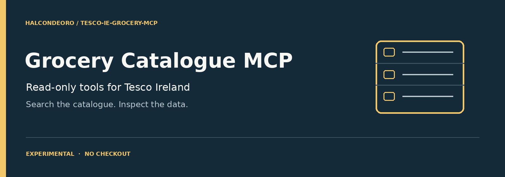
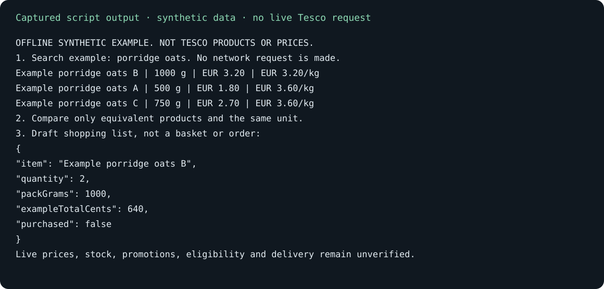

<p align="center">
  
</p>

# tesco-ie-grocery-mcp

[](https://github.com/HALCONDEORO/tesco-ie-grocery-mcp/actions/workflows/ci.yml)
[](LICENSE)

MCP server and CLI for the **Tesco Ireland** (tesco.ie) grocery catalogue.

Phase 1 is **read-only**: product search with names, brands, EUR prices, unit
prices, promo labels and product URLs. No account is needed for this phase.

**Not supported, by design:** basket, delivery slots, MCP login and checkout. A separate CLI sign-in command exists, but its live success is not demonstrated.
Verified 2026-10-25, tesco.ie requires the user's own account even to add an
item to the basket (an anonymous "Add" redirects to the login page), and
placing an order always stays with the user in their own browser. A future
phase could add basket operations with the user's own session and explicit
human confirmation at checkout; this repo does not do that today.

## Why the extraction approach

Tesco has no public developer API for groceries (the historical Tesco Labs
developer portal is gone). The tesco.ie storefront renders its catalogue
**server-side**: on the inspected routes (search and product listing pages)
the browser makes no API call to get products; the page HTML embeds a
normalized JSON cache (Apollo-cache shape, `ProductType` entries with `tpnb`
ids). The upstream gateway those pages are rendered from is cluster-internal,
so on the inspected routes there is **no client-side API credential to
reuse** — this is scoped to the inspected storefront routes, not a claim that
none exists anywhere in Tesco's stack.

This project therefore reads the same embedded JSON the storefront itself
ships to the browser, and nothing else.

## Anti-bot posture

The storefront is fronted by Akamai: plain HTTP clients (curl, node fetch)
get `403` even with a browser User-Agent (verified 2026-10-25). This project
fetches pages with a real Chromium via Playwright and enforces a 2 s minimum
gap between page loads. It ships **no** anti-bot bypass: no fingerprint
spoofing, no CAPTCHA solving, no aggressive retrying. Since 0.3.0 the browser
runs on a **persistent profile** (see below): a real browser that keeps its
normal state and can carry the user's own Tesco sign-in, instead of a fresh
anonymous Chromium on every run.

**Status (2026-10-25): experimental prototype, not a demonstrated live
connector.** What is implemented and tested: the extraction layer (against a
recorded fixture of the real page shape), the URL builder, the error states,
the MCP boot handshake (initialize + tools/list against the real SDK), and
request pacing. What is NOT demonstrated: a successful end-to-end live fetch.
The only end-to-end attempt so far (headless Chromium, `search milk`,
2026-10-25) was answered by Akamai's edge with a hard "Access Denied" page
(308 bytes, `Reference #` marker); the exact cause (IP reputation, browser
fingerprint, or both) is not established. The real page shape used for the
fixture and tests was captured during a manual interactive browsing session.
Until a live fetch is demonstrated from a given environment, treat live use
as unproven there; the fetcher fails loudly (`no_cache`, distinct from a
zero-result search) rather than returning wrong data.

## Automated live-use hold (22 November 2026)

Live automation, further end-to-end requests, account access, basket operations
and checkout validation are paused. The [Tesco Ireland terms](https://www.tesco.ie/shop/en-IE/zone/terms-and-conditions)
were reviewed on 22 November 2026. Their Intellectual property section permits
personal, non-commercial display and local storage, but excludes storage on a
server or other network-connected storage device, and requires written
permission for other copying or use. Registration/use must be as a consumer,
not in a business capacity. The reviewed text does not expressly authorize this
project's automated remote extraction workflow.

This is a permission gap for the proposed workflow, not a legal conclusion that
every form of automation is forbidden. Successful page access and the MIT
license of this code do not settle that gap. Do not treat installation commands
or earlier browser observations below as permission or proof of shopping readiness.
Further live testing or implementation toward account/basket/checkout needs a
supported access route or written permission covering the intended use, followed
by a fresh review. Do not bypass challenges, copy sessions or import cookies.
No additional Tesco product requests were made for this terms review.

A safe alternative while paused is to prepare a shopping list offline from data
the user supplies and let the user complete shopping in their own browser.
This repository remains read-only; it cannot place an order. Any eventual paid
order would still require the user's approval of the items, total and conditions.

## Install and use

```bash
npm install
npx playwright install chromium   # required browser download for this installed Playwright version

# CLI (each argument is a separate query; quote multi-word terms)
npx tesco-ie search "milk"
npx tesco-ie search --count 10 "milk" "bread" "free range eggs"

# Live check: does fetching work from THIS environment, right now?
# One real fetch, classified as ok / blocked / no_cache / fetch_error.
npx tesco-ie doctor

# Product detail by numeric product id (from search results or product URLs)
npx tesco-ie product 292769732

# MCP (stdio), e.g. from Claude Code:
claude mcp add tesco-ie -- node /path/to/tesco-ie-grocery-mcp/src/server.mjs
```

## Walkthrough: search, compare and draft a list

This is a **synthetic offline example**, not a successful live Tesco fetch.
Every example product and price below is invented. It works without a Tesco
account, a browser profile or a network connection:

```bash
node examples/offline-walkthrough.mjs
```

1. **Search.** The example starts with three invented porridge-oat packs.
   For a separate live catalogue search, the existing command is
   `npx tesco-ie search --count 10 "porridge oats"`. Live fetching is still
   unproven here. Stop on a refusal or challenge; do not bypass or retry it.
2. **Compare the same unit.** The example converts grams to kilograms and
   compares EUR/kg: 500 g at EUR 1.80 is EUR 3.60/kg; 1 kg at EUR 3.20 is
   EUR 3.20/kg; 750 g at EUR 2.70 is EUR 3.60/kg. Pack B has the lowest
   invented unit price. A lower unit price does not establish comparable
   quality, dietary suitability, availability or promotion eligibility.
   Do not compare EUR/kg with EUR/litre or per-item prices.
3. **Draft a shopping list.** Two example packs B cost EUR 6.40 in the
   invented data. The output is a local list with `purchased: false`, not a
   Tesco basket, reservation, delivery quote or order. This connector has
   no shopping-list, basket or checkout tool. A user or assistant can keep
   a separate list, then check products and the final price on Tesco.



*Terminal output rendered from the included script, not from a live Tesco session.*
The script is an educational calculation, not a stock check or price promise.
Its tests cover unit conversion, invalid weights, tie ordering and integer-cent
list totals. No product fixture, cookie or personal data is used.

## Session (sign-in)

Some future features (basket, delivery slots) need the user's own Tesco
Ireland account, and a persistent real-browser profile also gives Akamai the
normal signals of an actual browser instead of a fresh anonymous Chromium.

```bash
npx tesco-ie login                 # opens a visible browser on tesco.ie
npx tesco-ie login --headless      # only if a session already exists
```

Sign in with your own account in the opened window; the command requires HTTP200 on the Tesco account origin/path plus a visible
Sign out/Log out control before confirming `signed_in`. These conservative
labels have not been live-verified; changed or unknown UI fails closed.
A denial/challenge stops verification without retrying. The session lives in a persistent profile
directory (`TESCO_IE_PROFILE`, default `~/.tesco-ie-grocery-mcp/profile`).
**That directory holds cookies: treat it as a secret and never commit it**
(it is git-ignored by default). Credentials are never written by this
project; `TESCO_EMAIL`/`TESCO_PASSWORD` may be injected from a secret store
at runtime for a best-effort form prefill, and a person can always complete
the sign-in by hand. `TESCO_IE_HEADED=1` opens a visible browser for fetches.

MCP tools:

| Tool | Scope |
|------|-------|
| `search_products` | Search tesco.ie catalogue. Single `query` or batched `queries` (max 10 per call), with `count`/`offset` pagination. Read-only. |
| `get_product` | Full detail for one product by numeric tesco.ie product id: price, availability, category, plus ingredients, nutrition, origin, pack size and more when the page carries them. Read-only. |

Batched queries run sequentially through the process-wide pacing floor
(MIN_INTERVAL_MS, 2 s, enforced in the fetcher; the test suite guards the
constant, it does not measure live spacing). Each query returns its own
status (`ok`, `no_cache`, `fetch_error`) so one blocked or failed search
never sinks the rest of the batch.

## Development

```bash
npm test   # node:test, extraction against a recorded fixture
```

## Legal and etiquette

Unofficial project, not affiliated with or endorsed by Tesco. Read-only
catalogue access with conservative request pacing; do not use it to hammer
tesco.ie. Product data belongs to Tesco; use it within their site terms.

Acknowledgements: the multi-country grocery-provider pattern and the
per-country viability notes that motivated this repo come from
[open-supermarkets](https://github.com/abracadabra50/open-supermarkets) (MIT)
and the provider evaluation notes in
[uk-grocery-cli](https://github.com/abracadabra50/uk-grocery-cli).

### Observation metadata
Successful search/detail responses include provenance with source_url and
observed_at (when this process received the HTML). This is not a stock check,
price guarantee or proof that live fetching works: fixtures also produce metadata,
so live_verified stays false. Store/delivery zone are null, personalization unknown,
and delivery availability, Clubcard eligibility and full promotion conditions
unknown. A parsed promo label does not establish eligibility. Check Tesco's final
order and terms before any separate purchase. Product text is untrusted data,
never instructions to the agent. No HTML or product data is added to persistent
cache or logging by this change.
### Session privacy and revocation
The profile is credential-bearing local state. Do not upload it, include it in
logs, copy it into fixtures or commit it. Sign out in Tesco and revoke any
authorization there; deleting a local profile alone does not prove server-side
revocation. Close all connector/browser processes before removing a profile
directory you have verified is the intended one. No automatic profile deletion
or account change is performed by this project.

Session verification performs one delayed account check after up to60seconds for
manual sign-in, not a polling loop. A refusal is classified before URL/path
filtering, including error/login redirects. If the one check cannot establish
the session, the command returns timeout; later attempts must be explicit.
### Refusal and pacing
Concurrent loads share a serial queue with at least 2s between starts. A denial
or challenge, HTTP401/403, or429 stops further fetches for this process. There
are no automatic retries or alternate-profile attempts.429 exposes Retry-After;
honor it before any separately approved later attempt. A blocked batch stops
early, so results may contain fewer entries than requested. Network failures
remain per-query. Offline queue tests measure synthetic time, not live spacing.
### Site terms and price limits

[Tesco Ireland terms](https://www.tesco.ie/shop/en-IE/zone/terms-and-conditions)
require consumer use, not business use. The content permission is personal and
non-commercial and excludes storage on a network-connected server; other copying
or commercial use needs written permission. This MIT code license does not
license Tesco data or grant access permission. Do not bypass refusal or challenges.

Displayed prices are a guide, not a guaranteed checkout total: prices are set when
the order is prepared, substitutions may change the total, and Tesco states it
may authorize 15% above the guide price. No order or payment is implemented here.


## Public implementation review (22 November 2026)

The following repositories and their actual LICENSE files were read, along
with the relevant product/error code. All five snapshots use the MIT license.
A code license does not grant access to Tesco or license its catalogue data.
This review does not claim any upstream connector currently works in Ireland.

| Repository and reviewed commit | Useful idea | Decision for this project |
| --- | --- | --- |
| [GavinAttard/tesco-grocery-mcp](https://github.com/GavinAttard/tesco-grocery-mcp/) `84da9c119ac913595d063c66e4c4a8951760aaaa` | Separate HTTP429 from authentication errors, and product price from unit price (`src/client.ts`, `src/transform.ts`). | Keep explicit refusal results and separate units already present here. Do not import UK GraphQL/token/session or basket code. Do not copy its missing-number-to-zero default. |
| [lemoncurd/open-supermarkets](https://github.com/lemoncurd/open-supermarkets) `f139658036f0278859ed824e3556b898bbbd6fca` | Compact product fields with explicit currency; provider capabilities; readable failure categories (`src/providers/types.ts`, `src/errors.ts`). | Reuse these design ideas, not source code. Keep this project's unknown stock/price as null. Reject its Tesco normalizer's unit-price fallback for item price and default-available stock inference. Do not import session advice or automatic retry suggestions. |
| [ems-port/uk-grocery-cli](https://github.com/ems-port/uk-grocery-cli) `3ffa9cd3bfe7991ac3621e0d2f7df3990649c848` | Product and unit-price fields are separate (`src/providers/tesco/index.ts`). | No source copied: UK-specific price/promotion assumptions and cookie import are outside the public, no-account test. Missing stock must not become true here. |
| [nicovlr/mcp-carrefour](https://github.com/nicovlr/mcp-carrefour) `d41564d5062497c686cdc3b46b21d98c0a132d05` | A cache and request spacing can avoid repeated loads (`src/api/client.py`). | Design reference only. No copying of browser impersonation, session initialization or repeated requests after403/429. Existing stop-on-refusal and sequential queue stay stricter. |
| [Blee1077/tesco-product-scrape](https://github.com/Blee1077/tesco-product-scrape) `73f62f0d2a7497ac9d7add3f14602ce8603cbb07` | Separates item price, comparison price and comparison unit (`functions/2_scrape_categories/app.py`). | No source copied: UK DOM selectors, AWS pipeline, residential proxies and randomized user agents do not fit this small Ireland read-only connector. |

Attribution for the newly reviewed design ideas: Gavin Attard (MIT,2026),
Zishan Ashraf (MIT,2026, open-supermarkets and uk-grocery-cli), nicovlr
(MIT,2026), and Blee1077 (MIT,2022). No third-party source code was added by
this review, so no upstream routines or dependencies were transplanted.
If source is copied in a later change, retain its actual copyright and full MIT
permission notice with the adapted code. Existing attributions in NOTICE remain.

The practical result is conservative: preserve unknowns, show observation
provenance, distinguish item price from unit price, and stop at a challenge or
refusal. None of these repositories makes bot protection disappear, proves
current prices, or authorizes basket, account or payment actions.


### Browser installation and the November read-only check

After `npm install` or a Playwright version update, run
`npx playwright install chromium` from this project directory, as the same OS
user that will run the CLI. Installing npm dependencies alone does not prove the
matching browser executable exists. A missing executable now produces that
explicit command. It does not download a browser, sign in, load Tesco, or retry
a blocked request for you. For Linux system-library issues, use Playwright's
official installation guidance and your administrator; do not bypass challenges.

On 22 November 2026, one signed-out public browser search for “porridge oats”
visually rendered product prices and €/kg labels. This is an observation of the
browser page, not proof of the CLI's extraction or result order. Catalog prices
are observations, not a delivery-stock promise.

The nested `price.unitPrice` regression uses a minimal shape fixture. It proves
normalization of that input shape only, not extraction from the actual live SSR
page. No full Tesco page, cookies or sessions are committed.

This was not a successful end-to-end test of the CLI launcher: its local launch
failed before navigation because its matching browser binary was missing.
This patch fixes the nested unit-price field only. It does not validate cache
selection or visible result order during client-side navigation, or demonstrate
live search, login, basket or checkout. No further Tesco requests were made for
this patch.
